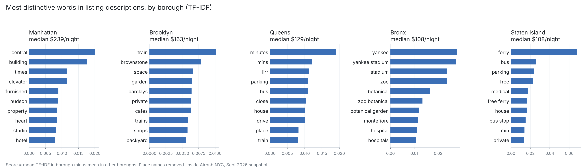

# How Airbnb Prices Vary by Neighbourhood in New York City

## Research Question

How do Airbnb prices vary by neighbourhood in New York City and over time? As a sub-question, how do hosts describe their listings differently across boroughs, and does that language line up with price differences?

## Team

| Member | Role |
|---|---|
| Justin | Proposal; results & interpretation |
| Stephen | Data cleaning; results & interpretation |
| David | Exploratory data analysis; documentation; results & interpretation |
| Deanne | Statistical analysis (TF-IDF text analysis); results & interpretation |
| Anne | Data visualization; results & interpretation |

## Data

- **Source:** [Inside Airbnb](https://insideairbnb.com/), New York City listings.
- **Snapshots:** March 2026, June 2026, and September 2026 quarterly scrapes. Each row is one listing as it appeared on the scrape date.
- **Key variables:** neighbourhood and borough (`neighbourhood_cleansed`, `neighbourhood_group_cleansed`), quoted nightly price (`price_quote_price_per_night`), room type, host type, reviews, availability, and listing text (`description`).
- **Cleaning:** we keep listings with a verified host, a non-missing price, availability, and some activity in the past year.
- **Ethics:** host names and exact coordinates are not published on this site. Results are reported only at the neighbourhood or borough level.

## Methods

*In progress.* The planned methods are:

1. Descriptive comparison of median quoted price by borough and neighbourhood across snapshots, aggregated by check-in week.
2. **TF-IDF analysis of listing descriptions.** Each description becomes a TF-IDF vector (unigrams and bigrams, stop words and place names removed). For each borough we rank terms by their mean TF-IDF in that borough minus their mean in all other boroughs. Duplicate descriptions are dropped first, because multi-listing hosts reuse templates. Code: `src/tfidf_descriptions.py`.

## Preliminary Results

**Preliminary result (September 2026 snapshot, 14,798 listings with unique descriptions):**

| Borough | Most distinctive terms | Listings | Median price/night |
|---|---|---:|---:|
| Manhattan | central, building, times, elevator, furnished, hudson | 5,779 | $239 |
| Brooklyn | train, brownstone, space, garden, barclays, private | 5,464 | $163 |
| Queens | minutes, mins, lirr, parking, bus, close | 2,650 | $129 |
| Bronx | yankee stadium, zoo, botanical garden, montefiore, hospital | 640 | $108 |
| Staten Island | ferry, bus, parking, free, medical | 265 | $108 |

Manhattan listings are marketed on centrality and building features such as elevators and furnished, hotel-style units. Outer-borough listings are marketed on travel time and transport (minutes, LIRR, ferry, bus, parking) and on specific destinations (Yankee Stadium, the zoo, hospitals). The cheaper the borough, the more its descriptions focus on how to get somewhere else. This is preliminary and descriptive. We have not yet tested whether these terms predict price within a borough.

## Limitations

- Prices are quoted prices, not booked prices, and each snapshot shows only one day.
- TF-IDF picks up landmark and transit words that partly stand in for location. Some place references, such as "central" (likely Central Park), survive the place-name filter.
- Bronx and Staten Island have few listings, so their term lists are less stable.
- English stop words only. Non-English descriptions are kept but not specially handled.

## Next Steps

- Add the March and June snapshots and compare price trends over time.
- Test whether distinctive terms predict price after controlling for borough and room type.
- Check term stability with a bootstrap over listings.

## Repository

Analysis code is in `src/` and outputs are in `outputs/`.
